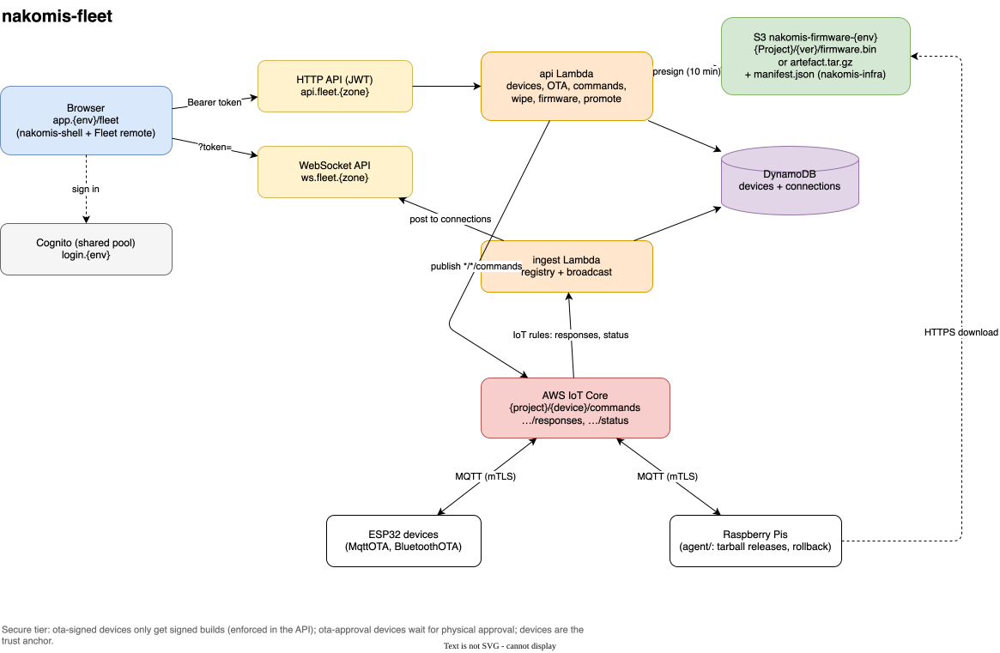

# nakomis-fleet — Unified device fleet management

Firmware OTA, configuration, and provisioning for nakomis ESP32 and Raspberry Pi devices, with a single web UI behind shared Cognito auth.

## Support

If you find this useful, please consider buying me a coffee:

[](https://www.paypal.com/donate?hosted_button_id=Q3BESC73EWVNN&custom=nakomis-fleet)

## Table of Contents

<!-- toc -->

- [What this is](#what-this-is)
- [Architecture Diagram](#architecture-diagram)
- [Repository layout](#repository-layout)
- [API](#api)
- [Development](#development)
- [Related repos](#related-repos)
- [Licence](#licence)
- [Support](#support)

<!-- tocstop -->

## What this is

A device-agnostic fleet manager, surfaced as the **Fleet** panel of the unified shell at
`app.nakomis.com/fleet` (and `app.sandbox.nakomis.com/fleet`):

- **Devices**: every IoT Thing plus every device that has published on `{project}/{deviceId}/responses` or `/status`,
  merged with a DynamoDB registry (project, firmware project, type, hardware, capabilities, notes, current version,
  last seen, OTA state). Live updates arrive over a WebSocket.
- **Firmware OTA**: pick a version from `nakomis-firmware-{env}` and push it to a device over MQTT (or over Web
  Bluetooth when the device is in range). The wire protocol is unchanged (`ota_update` / `url_chunk` / `ota_cancel`).
- **Optional secure tier**: devices with `ota-signed` are only offered, and the API only accepts, signed builds;
  `ota-approval` devices show "awaiting approval" rather than a hang; rollbacks are reported. Devices remain the
  trust anchor: Fleet is the "please update" button.
- **Commands, configuration, wipe and re-purpose**, and **sandbox → prod promotion** of builds.

Design and the reasoning behind it: [`docs/architecture/design.md`](docs/architecture/design.md).

## Architecture Diagram



## Repository layout

- `web/` — the Fleet Module Federation remote (Vite 8, React 19, MUI 7), published to `remotes/fleet/` of the
  shell's bucket. Copies `shell-contract.ts` from `nakomis-shell`.
- `infra/` — CDK `NakomisFleetStack`: device registry, HTTP API (`api.fleet.{zone}`, Cognito JWT), WebSocket API
  (`ws.fleet.{zone}`), IoT ingest rules, CI role. Lambdas in `infra/lambda/`.
- `agent/` — Raspberry Pi update agent (FLEET-5)
- `docs/architecture/` — design notes, draw.io source and generated SVG

## API

All routes need a Cognito access token from the shell's app client (`Authorization: Bearer …`).

| Route | |
|---|---|
| `GET /devices`, `GET /devices/{id}` | Registry merged with IoT Things |
| `PUT /devices/{id}` | Register or edit (`project`, `firmwareProject`, `deviceType`, `hwType`, `capabilities`, `notes`); mirrored onto the Thing |
| `POST /devices/{id}/ota` `{version}` | Presign (10 min) and publish `ota_update` / `url_chunk`s; enforces `ota-signed` |
| `POST /devices/{id}/ota/cancel` | `ota_cancel` |
| `POST /devices/{id}/command` `{command, …}` | Any command except `ota_update`/`url_chunk` |
| `POST /devices/{id}/wipe` `{project}` | Send `wipe`, move to another project |
| `GET /projects`, `GET /projects/{p}/firmware[?deviceId=]` | Builds per project (filtered for the device) and, in prod, promotable sandbox builds |
| `GET /projects/{p}/firmware/{v}/url` | Presigned URL for the Bluetooth path |
| `POST /projects/{p}/firmware/{v}/promote` | Prod only: copy a sandbox build into the prod bucket |

## Development

```bash
cd infra && pnpm install && pnpm test          # Jest
cd web && pnpm install && pnpm test && pnpm lint
cd infra && pnpm deploy-sandbox                # CDK by hand; CI deploys on merge
```

## Related repos

- [`nakomis-infra`](https://github.com/nakomis/nakomis-infra) — shared Cognito user pool, GitHub OIDC roles, and (forthcoming) per-environment firmware buckets
- [`bootboots`](https://github.com/nakomis/bootboots) — first ESP32 project to use the fleet; donates the existing `build_and_upload.py` and BLE service code
- [`esp32-bootloader`](https://github.com/nakomis/esp32-bootloader) — generic single-partition OTA bootloader used by all fleet ESP32 devices
- [`sandboxsite`](https://github.com/nakomis/sandboxsite) — current home of the firmware-management UI; will be gutted as Fleet takes over

## Licence

CC0 1.0 Universal — see [`LICENSE.md`](LICENSE.md).

## Support

If you find this useful, please consider buying me a coffee:

[](https://www.paypal.com/donate?hosted_button_id=Q3BESC73EWVNN&custom=nakomis-fleet)
